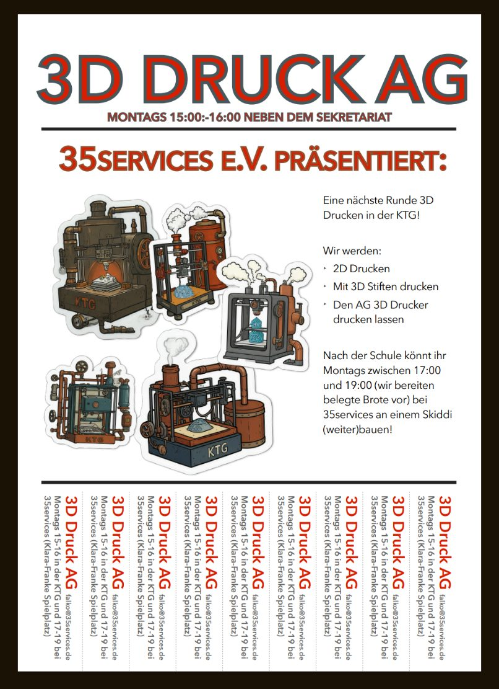

> Ergänze und ersetze nicht

Wir wollen KI nutzen um unsere Fähigkeiten zu ergänzen. Nicht um uns zu ersetzen.

KI sollte nur selbsgehostet von Kindern benutzt werden. Cloud KI ist kritisch zu betrachten. Es kann zum lernen benutzt werden. 

# DO
- benutze Apps die mit KI geschrieben wurden und open source sind (https://getartcraft.com/apps und co)
- generiere kleine Illustrationen, baue Plakate selber, schreib auf das Plakat, dass Illustrationen mit KI erstellt worden
- erstelle ASCII Diagramme mit KI
- programmiere mit KI, meistens reicht ein 20€ claude Abo
- programmiere mit lokaler KI
- nutze KI für Analysen von Code
- 

{: .gallery}

# DON't
- generiere ganze Plakate
- generiere keine Menschen Bilder/Gesichter
