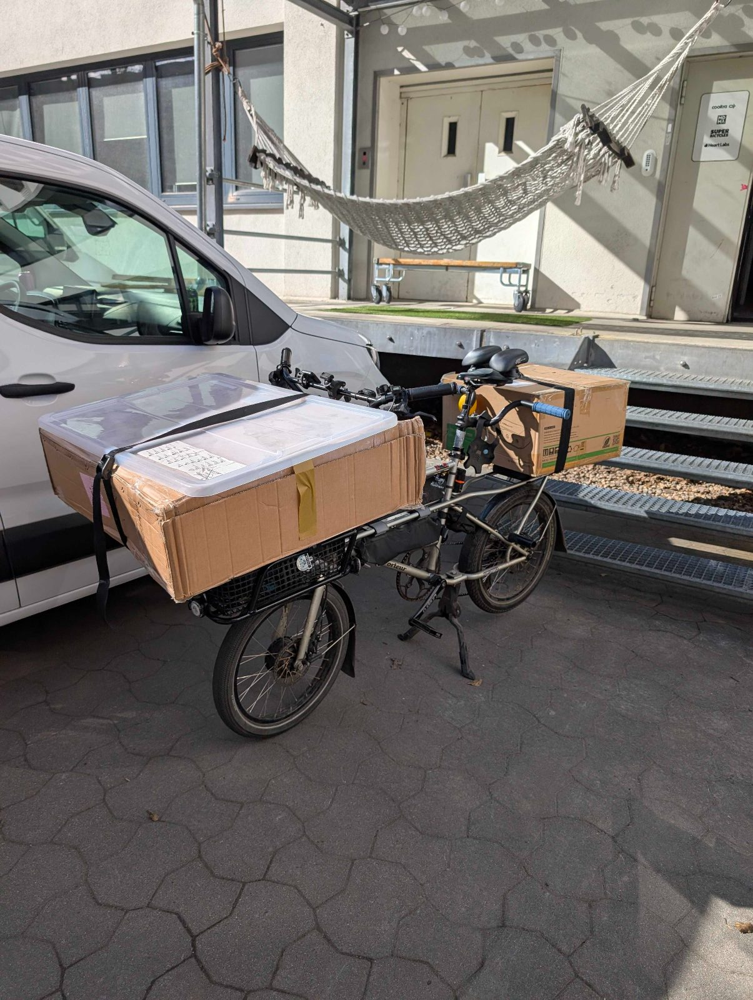
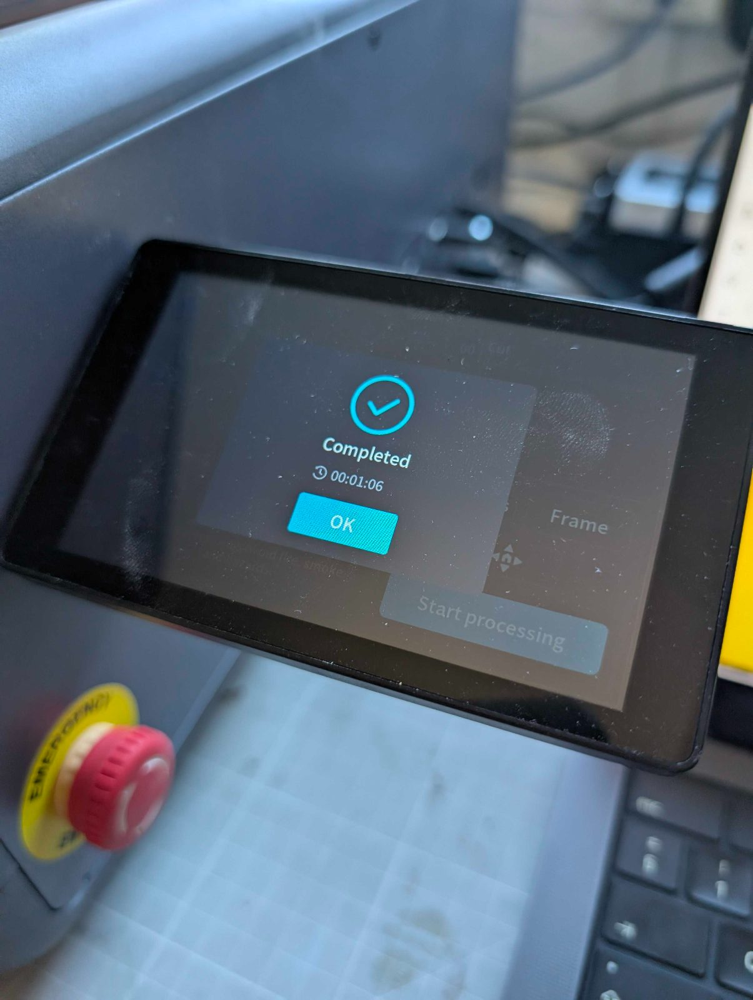
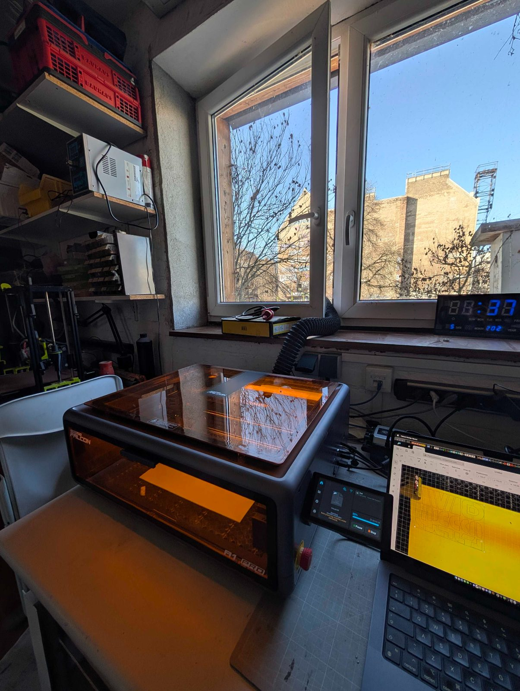

> Wir haben diesen Laser ausgeliehen bekommen. Vielleicht dürfen wir ihn auch behalten. Der kostet sonst mal eben 1000 €. Mit 20 Watt kann der auch ganz easy Sperrholz schneiden. Ich habe auch schon ein paar Schlüsselanhänger gelasert. Die Anleitung dafür ist wirklich sehr mager. Also wenn ihr euch da einlädt auf der Webseite könnt ihr einfach mal loslegen.

{: .gallery}
