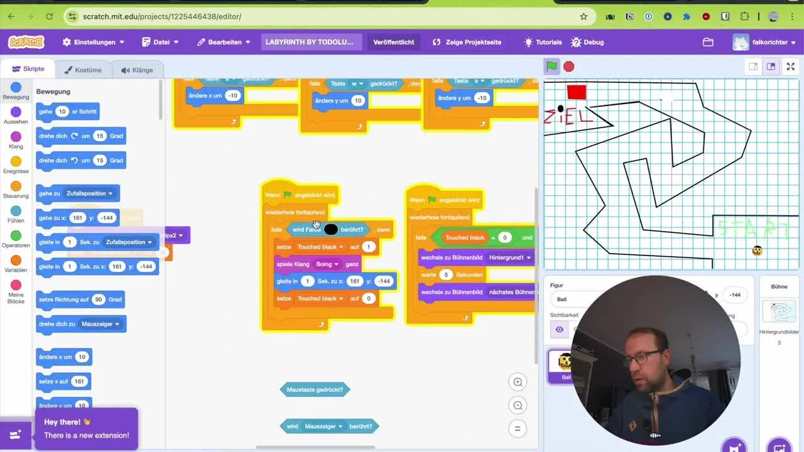

Mit diesem Video haben wir am Anfang der AG in der Schule Werbung für die [Programmierwerkstatt am Lessing-Gymnasium]({{ '/projects/programmierwerkstatt-lessing-gymnasium/' | relative_url }}) gemacht: Falko zeigt in knapp drei Minuten, was man mit Scratch bauen kann – zum Beispiel ein Labyrinth-Spiel mit Start und Ziel.

<a class="video-link" href="https://www.youtube.com/watch?v=g7Fhp1XMXIE" target="_blank" rel="noopener">
  
  ▶ Video auf YouTube ansehen
</a>
