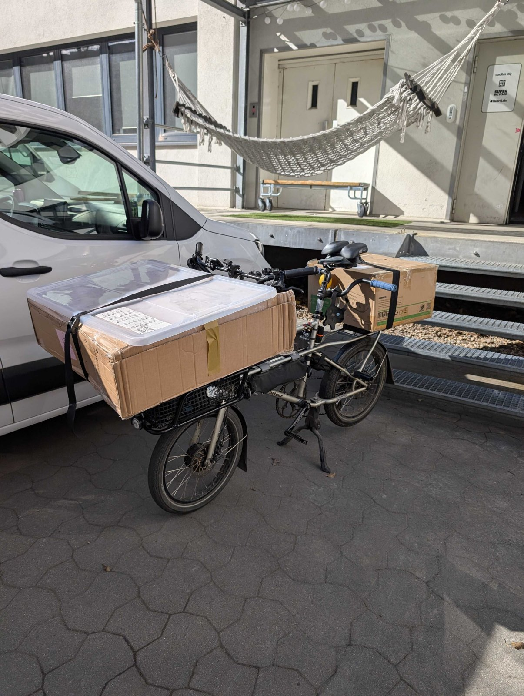
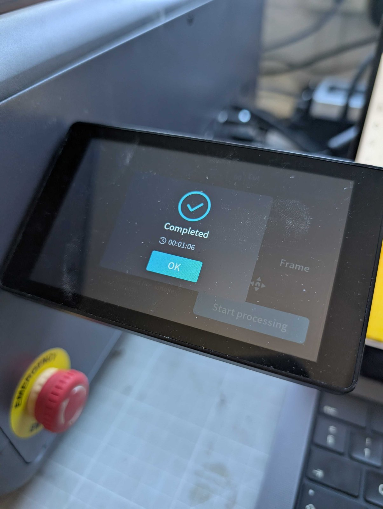

Den [Laser]({{ '/equipment/creality-a1-pro/' | relative_url }}) von Philippe Bietenholz habe ich ausgeliehen und mit dem Fahrrad abgeholt – zwei Kartons, festgezurrt auf dem Lastenrad.

{: .gallery}

Am selben Tag gleich der erste Test: Ein Creality Falcon mit 20 Watt schneidet die ersten Formen für unseren [Blockface-Klassensatz]({{ '/projects/blockface-klassensatz/' | relative_url }}) aus.

Nach einer Minute und sechs Sekunden war der Job fertig.

{: .gallery}
