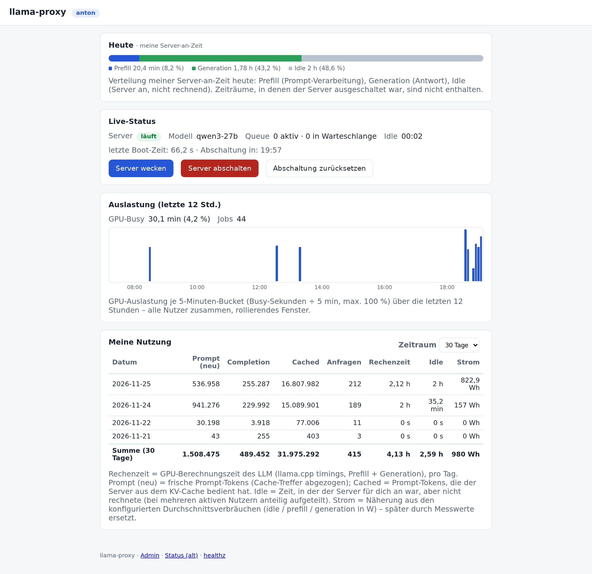

Der Server steht jetzt im Keller und läuft im Alltag: Kabel und Stromversorgung für den Pi sind an, und der erste echte Wake-on-LAN-Rundtrip – Request, Wecken, Booten, antworten, nach zwanzig Minuten Leerlauf automatisch Ausschalten – hat geklappt. Betrieben wird er großteilig mit Solarstrom: Von Mitte Februar bis Mitte November liefert die Sonne hierzulande genug, im Winter reicht sie dann nicht ganz.

**An- und Abschalten auf Wunsch**

Auf der Web-Oberfläche gibt es einen roten „Server abschalten"-Button. Ein Klick registriert nur einen Abschalwunsch für den, der gedrückt hat: Der Server geht erst aus, wenn alle Nutzer, die im zwanzig-Minuten-Fenster aktiv waren, zugestimmt haben – oder wenn ihr Fenster abgelaufen ist. Laufende Jobs anderer bleiben unberührt, und wer selbst wieder aktiv wird, hebt seinen Wunsch einfach auf.

**Auslastung: zwölf Stunden statt zwanzig Minuten**

Der frühere Balken ist ein Graph geworden: die letzten zwölf Stunden in fünf-Minuten-Buckets, aufsummiert über alle Nutzer, bei jedem gleich. Die Buckets liegen an festen Fünf-Minuten-Grenzen, dadurch bleibt ein Job bei jedem Refresh im selben Balken.

So sieht die Web-Oberfläche aus – Status, Auslastung und Nutzung auf einen Blick:


{: .gallery}

**Anbinden: OpenCode und pi**

Der Server ist über Tailscale unter `http://100.82.56.25:8080/v1` erreichbar und spricht die OpenAI-kompatible API – mit dem eigenen Key.

Für OpenCode (`~/.config/opencode/opencode.json`):

```json
{
  "$schema": "https://opencode.ai/config.json",
  "model": "qwen3-27b",
  "provider": {
    "llama": {
      "npm": "@ai-sdk/openai-compatible",
      "name": "Qwen3.8-27B (V100, via llama-proxy)",
      "options": {
        "baseURL": "http://100.82.56.25:8080/v1",
        "apiKey": "lp-…"
      },
      "models": {
        "qwen3-27b": {
          "name": "Qwen 3.8 27B",
          "limit": { "context": 100000, "output": 32768 }
        }
      }
    }
  }
}
```

Für den pi-Coding-Agenten (`~/.pi/agent/models.json`):

```json
{
  "$schema": "https://pi.dev/schemas/models.schema.json",
  "providers": {
    "llama": {
      "name": "Qwen3.8-27B (V100, via llama-proxy)",
      "baseUrl": "http://100.82.56.25:8080/v1",
      "apiKey": "lp-…",
      "api": "openai-completions",
      "models": [
        { "id": "qwen3-27b", "name": "Qwen 3.8 27B", "contextWindow": 100000, "maxTokens": 32768 }
      ]
    }
  }
}
```

Dazu in `~/.pi/agent/settings.json`:

```json
{ "defaultProvider": "llama", "defaultModel": "qwen3-27b" }
```

Einziger Aufwand: euren Key an der `lp-`-Stelle eintragen.
