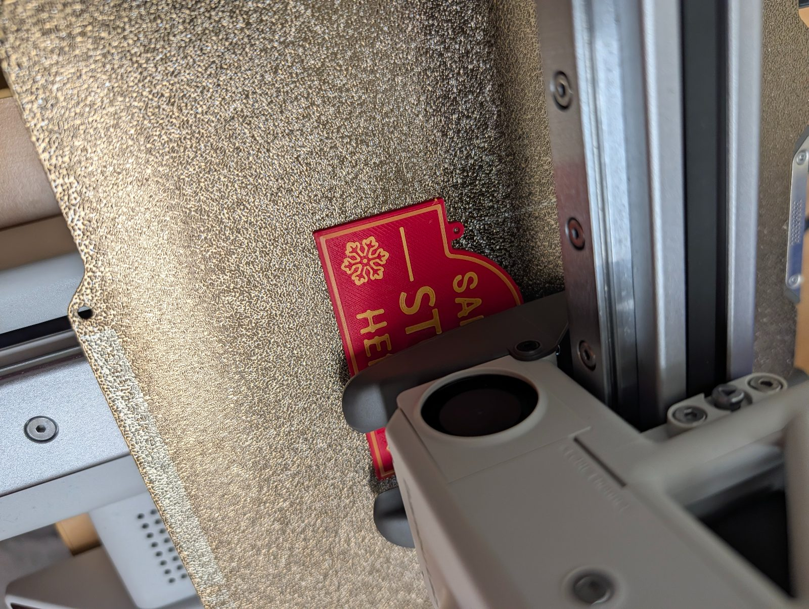
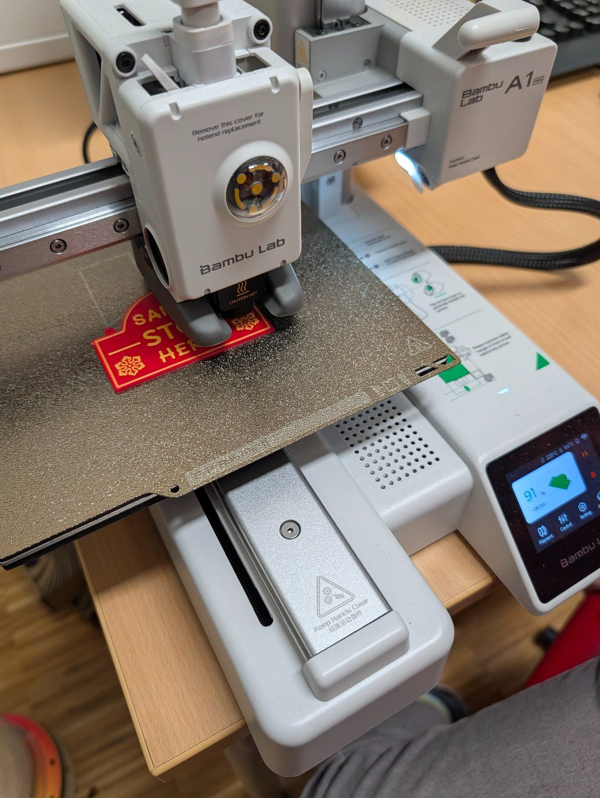
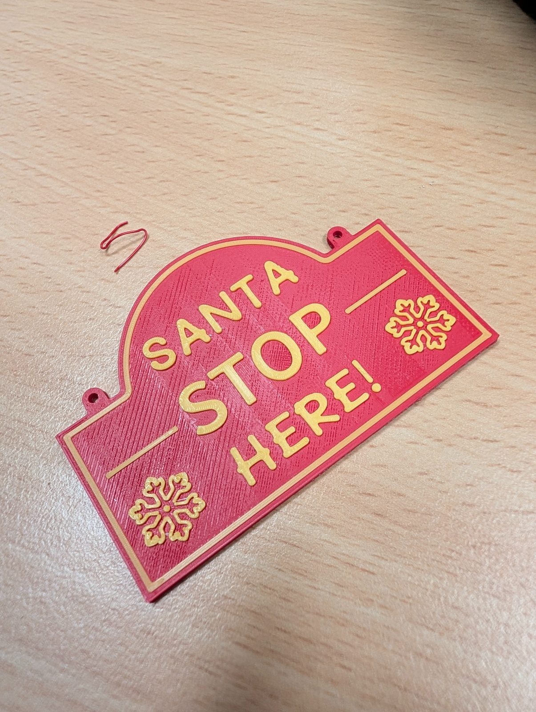

Wir brauchen ein AMS lite [3djake.de/bambu-lab/ams-lite](https://www.3djake.de/bambu-lab/ams-lite)

Spendet gerne für den Förderverein: [platanus-schule.de/platanus/foerderverein/](https://www.platanus-schule.de/platanus/foerderverein/)

- [github.com/35services/3d/tree/main/weihnachten](https://github.com/35services/3d/tree/main/weihnachten) für Max - da ist der Snowman den Max mit seinem Snapmaker U1 drucken könnte
-

{: .gallery}
