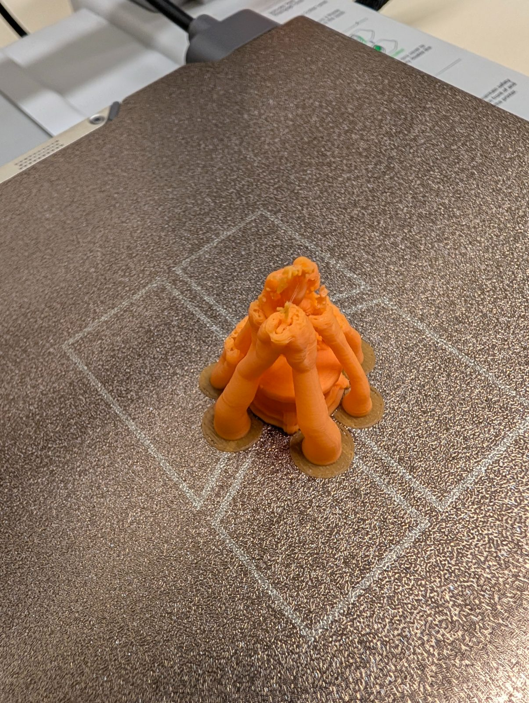
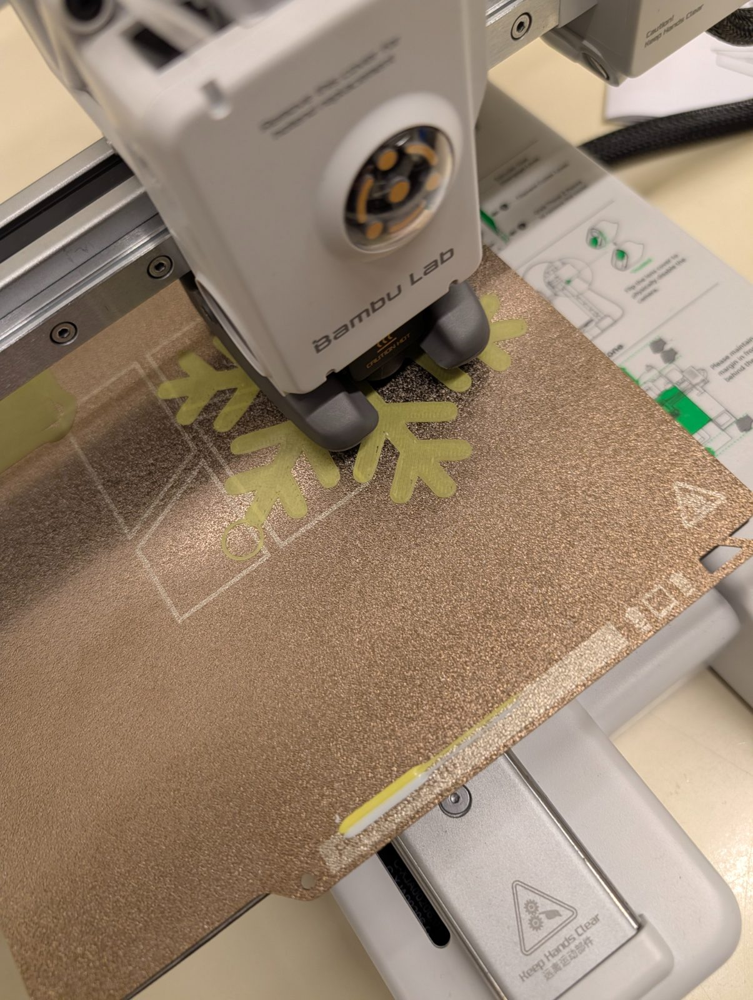
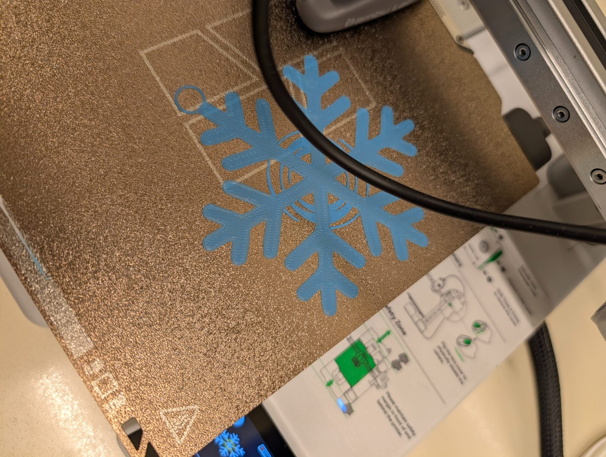
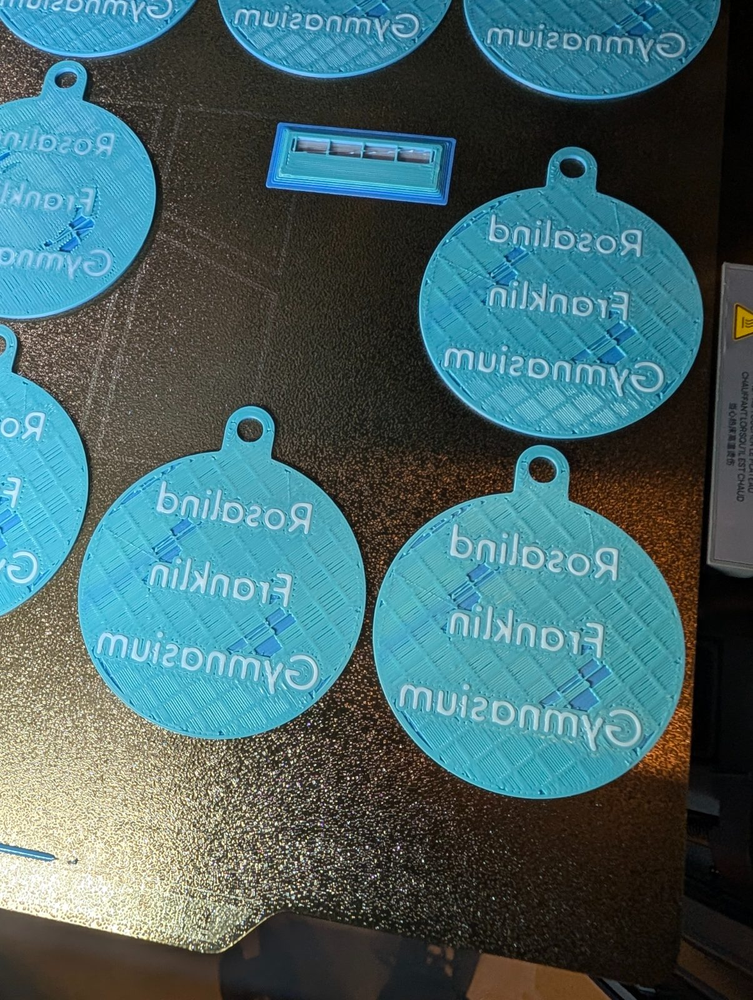
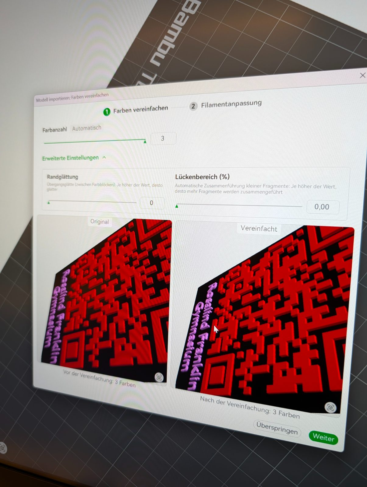
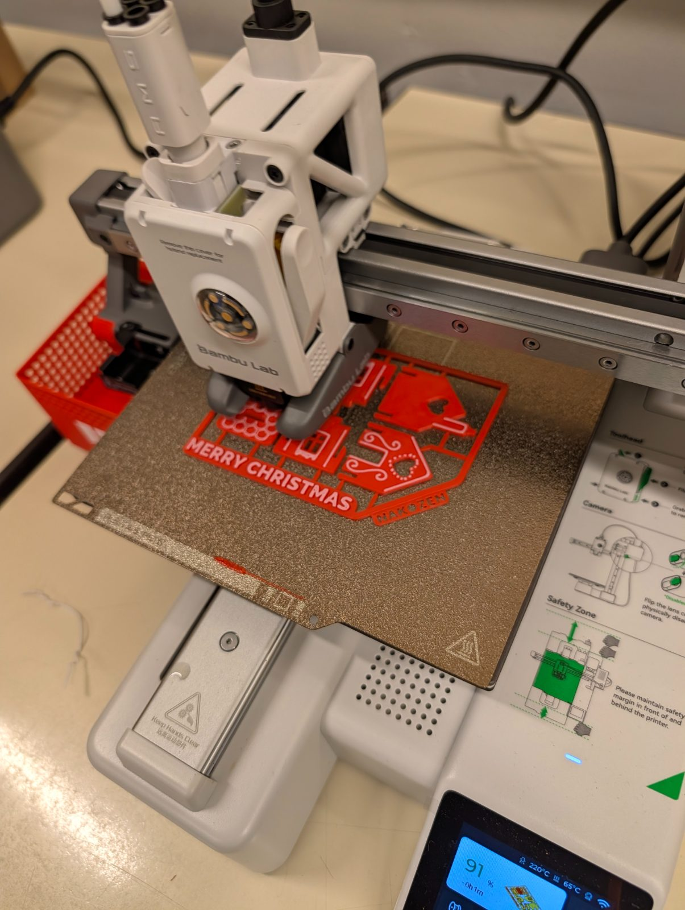
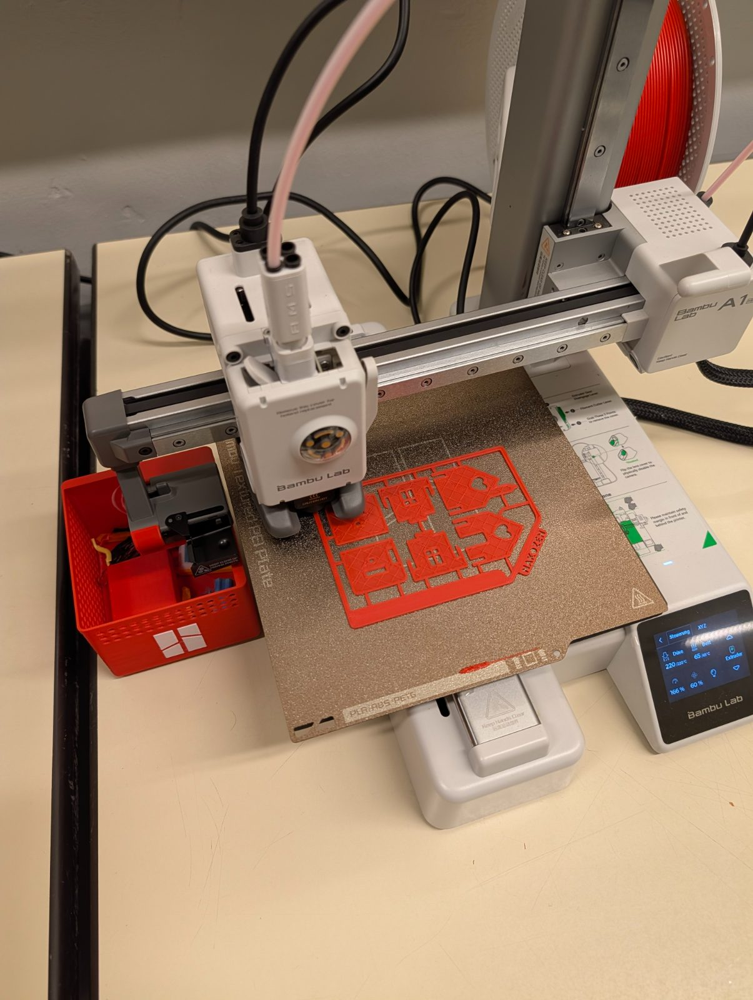

Viel erreicht im Zusatztermin 💪💪💪 Aus Blender mehrfarbig gedruckt. Manuell Filament gewechselt für Mehrfarbdruck an den A1 und gute Unterhaltungen!

{: .gallery}

## Dinge aus der Druckwerkstatt:
* https://www.printables.com/model/143185-gingerbread-house-kit-card/files in Farbe:

[make_ornament.py](https://github.com/falkorichter/2d/blob/main/ornament/make_ornament.py) ausprobiert am Logo der Schule:

