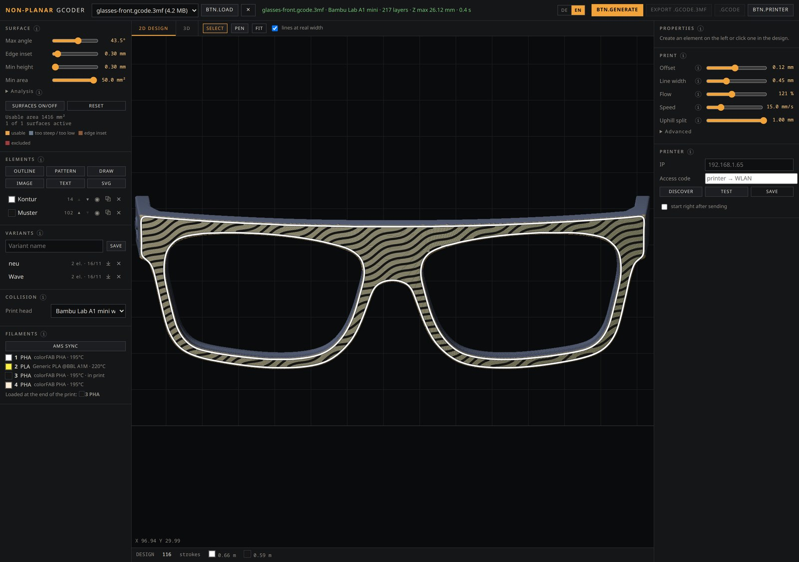
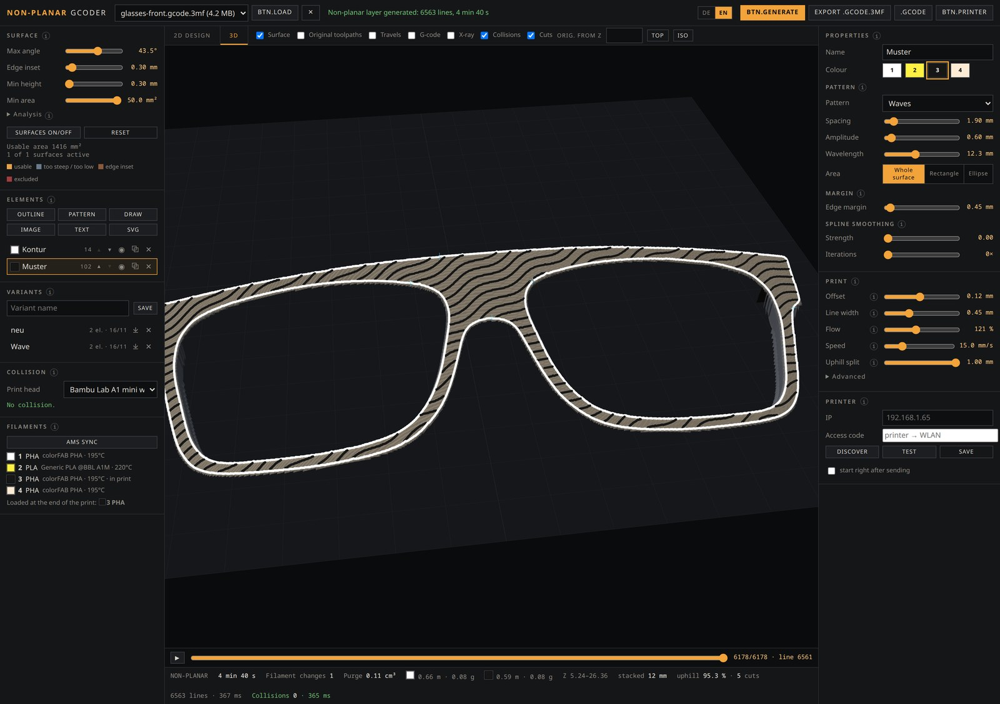

Wer eine gewölbte Fläche druckt, bekommt Treppen. Non-planarer Druck löst das, indem die Düse der Form folgt statt in flachen Schichten zu bleiben – die Oberfläche wird glatt, weil die Bahnen sich der Wölbung anschmiegen.

**Impasto** geht dabei einen anderen Weg als ein non-planarer Slicer: Es slict nicht neu, sondern nimmt den **fertig geslicten G-Code aus Bambu Studio** und hängt genau **eine zusätzliche Schicht** an – die Dekoration. Damit bleibt die gewohnte Druckqualität und der normale Arbeitsablauf erhalten, und obendrauf kommt Farbe.

{: .gallery}

## Warum nicht einfach ein anderer Slicer?

Der Ansatz entstand nach Versuchen mit PancakeSlicer, der auf der Orca-Engine aufsetzt. Das Ergebnis war nicht schlecht – aber nicht gut genug, um den gewohnten Bambu-Workflow dafür aufzugeben. Ein non-planarer Slicer plant den **ganzen** Druck neu; hier sollte nur der letzte Schritt dazukommen. Aus dieser Einschränkung kommt die eigentliche Idee: nicht mehr anfassen als nötig.

## Was es kann

- **Elemente:** Konturen, Muster, Kringel, Freihandlinien, Bilder, Text und SVG – jedes Element lässt sich verschieben, skalieren, drehen und einfärben.
- **Bis zu vier Farben** mit echten Filamentwechseln über Bambus eigenen Wechsel-G-Code, inklusive Purge-Berechnung über die Flush-Matrix.
- **Eine Höhenkarte von oben** statt einer Neukonstruktion: Aus den vorhandenen Bahnen wird die Oberfläche rekonstruiert, daraus die Neigung. Die Düse fährt auf der Düsenfläche plus Abstand.
- **Bergauf statt bergab:** Jeder Abschnitt wird vor dem Druck bewertet. Bergab schiebt die flache Düse Material mit, deshalb wird bevorzugt bergauf gedruckt; über Kuppen wird ein Strich geteilt und beide Hälften von unten nach oben gesetzt.
- **Fahrweg-Optimierung:** Die Reihenfolge aller Abschnitte wird global geplant (Nearest Neighbour, dann 2-opt und Or-opt, kleine Gruppen exakt). Der Regler „Bergauf-Gewicht" legt fest, wie viel Fahrweg ein Millimeter bergab wert ist.
- **Kollisionsprüfung** gegen Kopfprofile – optional, weil sie Rechenzeit kostet. Die Profile stammen aus PancakeSlicer.
- **AMS-Zuordnung und direktes Senden** an den Drucker über FTPS und MQTT.

{: .gallery}

## Was es nicht ist

Impasto ist **kein Slicer** und will keiner sein. Es kann keine Stützstrukturen planen, keine Schichthöhen optimieren und keine mehrseitigen non-planaren Bauteile bauen. Es ist ein Werkzeug zum **Gestalten und Beschriften von Oberflächen** – eine erhabene Linie, ein Muster, ein Bild, ein Wort auf einem Bauteil, das ohnehin schon gedruckt wird.

## Grenzen, ehrlich gesagt

- Die Stapelung liest die gedruckten Linien an ihrer Mitte. Überlappungen unter etwa einer halben Linienbreite heben nicht an.
- Der Warp-Ausgleich ist ein Modell, keine Messung: Er hebt ein Bauteil zu den Enden hin an, damit die Düse auf einem verzogenen Teil nicht schleift. Wie stark, muss man am eigenen Druck messen.
- Auf Schrägen sitzt eine flache Düse zwangsläufig höher. Der Spalt wird über den Volumenstrom ausgeglichen, nicht über die Geometrie.

## Stand

Version 0.4.0, 140 Tests, offen auf GitHub: **[3p1cball-code/impasto](https://github.com/3p1cball-code/impasto)** (AGPL-3.0-or-later, weil Kopfprofile aus PancakeSlicer enthalten sind). Die ersten Drucke sind vielversprechend – die Brillenfront auf diesen Bildern war das Testbauteil, weil sie eine gleichmäßig gewölbte Fläche mit klaren Kanten hat.
