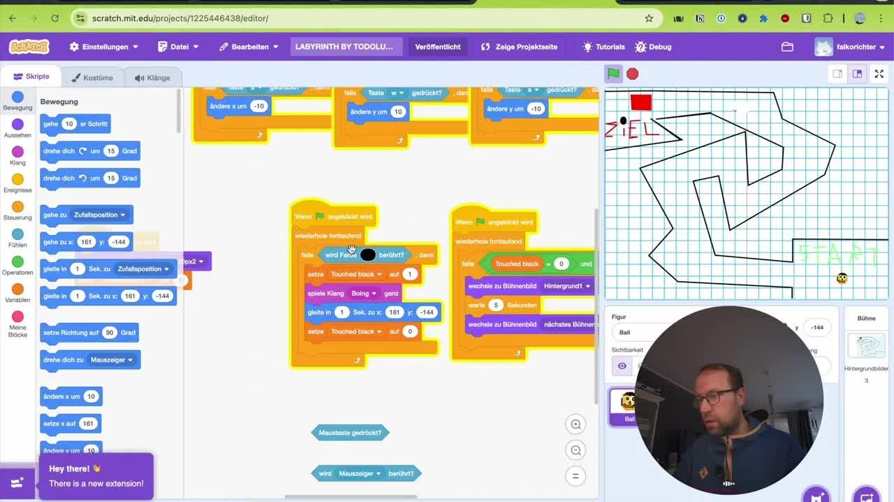

Im Herbst 2025 hat Falko am Lessing-Gymnasium eine **Programmierwerkstatt** von 35services angeboten. Die Idee: Fortschritt und Ideen dokumentieren, damit es ähnliche Werkstätten später auch an anderen Orten geben kann.

**Worum ging es?**

- **Grundlagen des Webs:** Was ist eine Webseite, was ist eine Domain, Top-Level-Domain, Subdomain, ein Pfad? Wie loggt man sich ein, speichert und „remixt“ Projekte?
- **Programmieren mit [Scratch](https://scratch.mit.edu/):** Was sind Sprites und Audio-Schnipsel? Kleine Routinen lesen und verstehen – und lernen, Wiederholungen im Code zu vermeiden.
- **Fortgeschrittene Themen** als Ideen für später: Cloud-Variablen, Highscore, Einstellungs-Bildschirm, Modulo, saubere Klick-Behandlung, Kommentare und „Clean Code“, Nachrichten zwischen Figuren schicken.

Am Anfang der AG haben wir mit einem kurzen [Vorstellungsvideo]({{ '/news/2025/10/01/vorstellungsvideo-programmierwerkstatt-lessing-gymnasium/' | relative_url }}) in der Schule Werbung gemacht:

<a class="video-link" href="https://www.youtube.com/watch?v=g7Fhp1XMXIE" target="_blank" rel="noopener">
  
  ▶ Video auf YouTube ansehen
</a>

Als Material hat Falko Tipps wie [inf-schule.de](https://inf-schule.de/) und [appcamps.de](https://appcamps.de/), Lernkarten und mehrere Bücher zu Scratch gesammelt.

Alle Notizen stehen im Beitrag [Programmier Werkstatt am Lessing Gymnasium]({{ '/news/2025/10/09/programmier-werkstatt-am-lessing-gymnasium/' | relative_url }}).

[Wie lange lief die Werkstatt, wie viele Kinder waren dabei, was ist entstanden? – Details folgen.]
